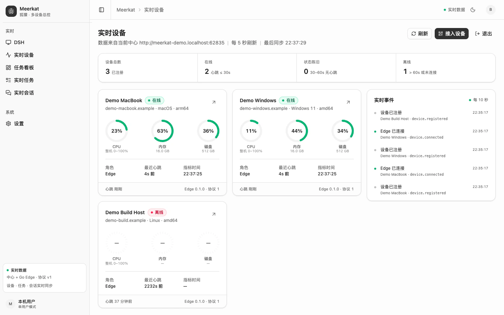
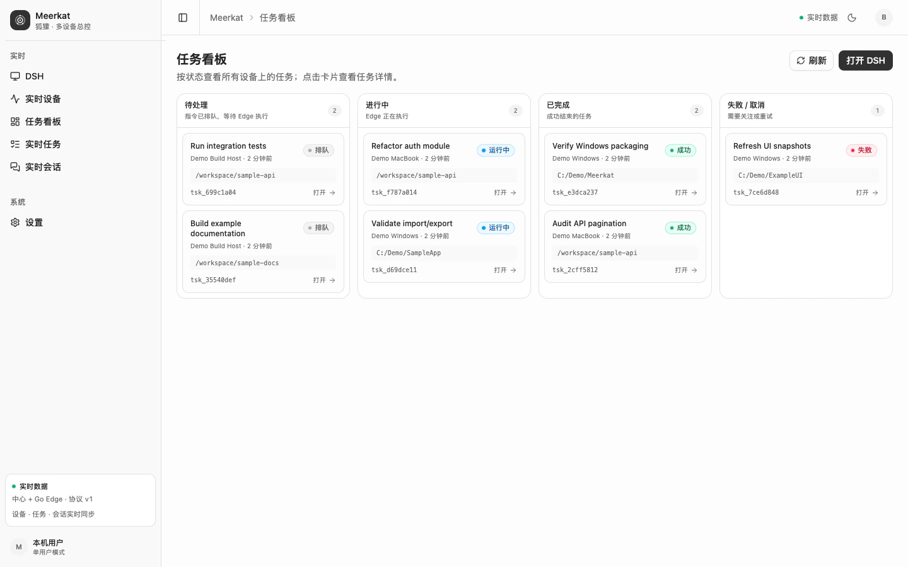
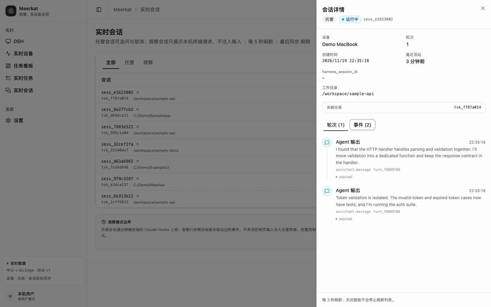

# Meerkat 狐獴

**一个面向单用户的多设备 Agent 控制面。**

在一台机器上启动 Hub，把运行编码 Agent 的多台电脑和手机接入同一个工作区。不用来回切远程桌面、也不用额外折腾组网，在一个统一入口里就能选设备、派任务、看看板、打开远程 Agent 会话并预览产物。任务直接在目标设备上运行，使用那台机器本地的代码目录与开发环境。



## 核心特性

### 一个 Hub 管多台设备，多设备统一入口
一台电脑作为 Hub 管理整个工作区，其余 macOS、Windows 设备作为 Node 通过一次性邀请码（支持复制或扫码）接入。你可以在同一个界面里查看所有设备的在线状态和资源用量，按需选定设备与工作目录派发任务，或直接打开任一设备上的远程 Agent 环境（DSH），多台机器之间随时切换。

### 内置 tsnet 组网，无需额外安装 Tailscale
Hub、各设备上的 Edge 进程以及 Android 客户端都内嵌了 Tailscale（`tsnet`）网络栈。不需要在操作系统里单独安装 Tailscale 客户端，也无需配置公网端口映射；首次在界面中通过浏览器完成一次授权后，跨网段设备即可自动加密直连并在断线后重连。

### 桌面、手机、网页多端可用
- **桌面端（macOS / Windows）**：基于 Go 与 Wails 的自包含原生应用，内置 Hub、Edge 与界面，既可以创建新工作区，也可以作为节点加入已有工作区。
- **手机端（Android）**：内置 tsnet 与本地反代，通过一次性配对码接入 Hub 并使用独立的只读设备凭证，随时在手机上查看设备状态、任务列表并打开远程 Agent 会话。
- **Web 面板**：与桌面端共用同一套前端界面，也支持通过浏览器访问和本地开发调试。

### 任务看板与会话追踪
提供按「待处理 / 进行中 / 已完成 / 失败或取消」分栏的实时设备任务看板，集中掌握多台设备上的任务进度与执行结果。点开任意会话即可查看 Agent 的实时流式输出与上下文，并对支持的会话继续追问。

### 远端 HTML 本机浏览器直开预览
在远程设备的差异或文件面板中打开 HTML 页面时，桌面端会通过短效一次性票据将内容代理到本机，直接调用你的默认浏览器打开预览，完整保留页面样式与交互，无需手动把文件传回本机。首次打开前会弹出确认提示并记住选择，你也可以随时在「设置」里调整询问策略。

### 自动更新与状态可见
桌面端在「设置」中集中展示当前版本号与更新状态，系统托盘也提供快捷入口。Windows 端支持 Ed25519 更新清单签名与安装包 SHA-256 校验，会在设备空闲且没有进行中任务时自动下载安装，遇到安装或启动异常时自动尝试回滚旧版；macOS 与 Android 的自动安装仍在完善中。

## 界面演示

以下截图均使用演示数据。

### 实时设备



### 任务看板



### 会话详情



## 快速开始

### 下载安装

Windows 用户可以直接从 [GitHub Releases](https://github.com/teleJa/meerkat/releases) 下载最新版本安装包（`Meerkat-Setup-*.exe`），安装后默认支持后续自动更新。macOS 或需要自定义构建的用户可按下方步骤从源码打包。

### 从源码启动桌面工作区

从源码构建需要 Go 1.27.3、Node.js、pnpm 和 make；Windows 运行环境需要 WebView2 Runtime。在仓库根目录安装前端依赖并构建 Web 界面：

```bash
(cd web && pnpm install --frozen-lockfile)
make web
```

随后按下方的「打包」步骤构建并打开桌面应用：

1. **创建工作区**：在第一台电脑上选择「创建新工作区」，打开「设置 → 网络」，启动内嵌 Tailscale 并按提示完成浏览器授权。
2. **接入其他设备**：在 Hub 上点击「邀请设备」生成邀请码；在另一台电脑打开 Meerkat 选择「加入现有工作区」粘贴邀请码，或在 Android 客户端输入移动端配对码完成接入。
3. **开始使用**：设备上线后，即可在「实时任务」或「任务看板」中派发与跟踪任务，或在「Harness」中直接打开目标设备的 Agent 环境。

### 启动本地 Web 开发面板

完成上面的 Web 构建步骤后，从仓库根目录启动本地开发中心：

```bash
(cd center && pnpm install --frozen-lockfile && MEERKAT_HOST=127.0.0.1 pnpm dev)
```

浏览器打开 `http://127.0.0.1:8787/#/live`，使用启动时生成在 `center/data/admin-token` 中的令牌登录。

## 仓库结构

| 目录 | 职责 |
|---|---|
| [`desktop/`](desktop/) | macOS / Windows 桌面应用（含内嵌 Go Hub、自动更新与预览代理）及 Android 客户端。 |
| [`edge/`](edge/) | 运行在各目标设备上的 Go 进程，负责内嵌 tsnet 接入 Hub、执行任务、管理 DSH 与上报状态。 |
| [`web/`](web/) | 设备、任务看板、会话与设置前端界面，同时服务于桌面端和浏览器。 |
| [`center/`](center/) | 独立运行的本地开发中心，为 Web 调试提供 API 与 WebSocket 服务。 |
| [`shared/protocol/`](shared/protocol/) | Hub 与 Edge 之间的通信协议与消息样例。 |

## 打包

在 macOS 构建机上，从仓库根目录执行：

```bash
make package-macos          # macOS App
make package-win-portable   # Windows x64 免安装 ZIP
make package-win            # Windows x64 免安装 ZIP 和 NSIS 安装包
make package-all            # 同时构建 macOS 与 Windows 产物
```

macOS 构建需要 Xcode 命令行工具；Windows 安装包构建需要 Docker（含 NSIS 镜像）或本机 `makensis`。构建产物统一输出在 `desktop/MeerkatDesktop/bin/`。

## 许可证

Meerkat 使用 [Apache-2.0](/LICENSE) 许可证。
