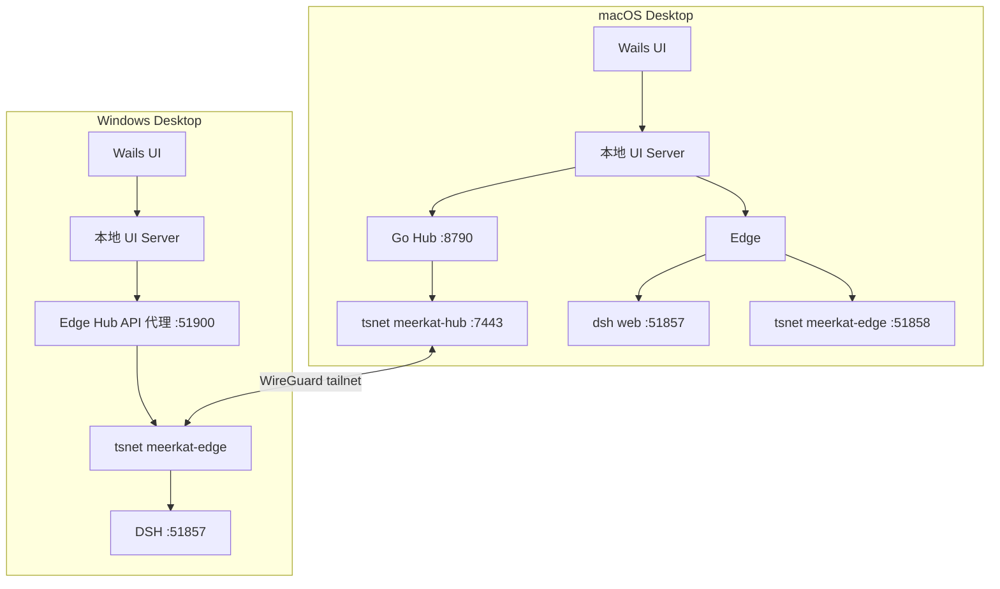

# 网络与安全

## 1. 网络平面

Meerkat 不要求用户安装系统 Tailscale。Hub 和 Edge 都使用 `tailscale.com/tsnet` 内嵌节点：

| 节点 | hostname | 作用 |
| --- | --- | --- |
| Hub | `meerkat-hub` | 在 tailnet 上提供 Hub API（端口 7443）；对外优先使用 MagicDNS 地址 `http://meerkat-hub:7443` |
| Edge | `meerkat-edge` | 加入 tailnet，连接远端 Hub，并暴露本机 DSH 端口 51858 |



- tsnet 状态写入 `tsnet-status.json`，包含 `state`、`auth_url`、`tailscale_ips`、`local_api_url`；
- Edge 自动配对阶段写入 `pairing-status.json`（`waiting_network`/`pairing`/`paired`/`error`），供 App 展示进度与失败原因；
- 系统 Tailscale 开启/关闭不影响内嵌节点；
- Hub/Edge 启动时自动使用内嵌网络；登录需要 tailnet 授权时以 `auth_url` 暴露给设置页，Edge 需要登录时 App 还会自动打开该授权页：同一授权地址只自动打开一次，地址变化在 30 秒冷却后才会重开，避免反复弹窗；界面按钮可随时手动重开。

## 2. 端口与监听面

| 监听 | 绑定 | 认证 |
| --- | --- | --- |
| 桌面内嵌 Hub HTTP `8790` | Desktop 默认 `127.0.0.1`；仅 `allow_lan=true` 可绑非 loopback | admin bearer、移动 bearer 或 HttpOnly session |
| Hub tsnet `7443` | tailnet IP | 同上（tailnet 内部） |
| Hub DSH proxy `8801-8900` | `127.0.0.1` | 服务端 DSH cookie jar |
| `/harness-proxy/{id}/...` | 随 Hub HTTP/tsnet | session 或移动凭证（`harness:proxy`） |
| Edge 本地 Hub API `51900` | `127.0.0.1` | 由 Desktop 代理注入 Bearer |
| Edge DSH `51857` | `127.0.0.1` | DSH 自己 token/cookie |
| Edge tsnet DSH `51858` | tailnet IP | 原始 TCP 转发，DSH 自己认证 |
| Desktop 本地 UI | `127.0.0.1:<随机>` | 本机；Wails |
| 单实例锁 | `<配置目录>/instance.lock` | OS 文件锁；第二个实例提示 PID 后退出 |

## 3. 认证与授权

### 管理端

- Hub 默认只绑定 `127.0.0.1`；需要局域网/远程访问时必须在 `config.json` 显式设置 `"allow_lan": true`。旧配置里的 `bind_host: "0.0.0.0"` 在 `allow_lan` 未开启时会被忽略并记录日志。
- 同一配置目录只允许一个实例；`instance.lock` 用 OS 文件锁持有，进程退出/崩溃自动释放；第二个实例读取锁内 PID 后提示并退出。
- admin token 首次启动生成，文件权限 `0600`；
- `POST /api/session` 用 admin token 换 12h HttpOnly session cookie；
- `requireAuth` 同时接受 `Authorization: Bearer <admin>`、`Authorization: Bearer mkm_...` 和 `meerkat_session` cookie；
- 修改类请求要求 `x-meerkat-request: 1`，防 CSRF；移动凭证一律拒绝写操作；
- 桌面 UI 的本地代理会在 bundled/node 模式注入 admin Bearer（如果配置了 token）。

### 移动设备凭证

- `POST /api/mobile/pairing-tokens`（管理员）生成 `MEERKAT-XXXX-XXXX`，10 分钟、一次性、只存 SHA-256；
- App 用配对码调用 `POST /api/mobile/register`，换取长期 token `mkm_<credential_id>_<secret>`；Hub 只存 hash；
- 移动凭证固定 scopes：`devices:read`、`tasks:read`、`harness:proxy`；有效期 90 天；
- 撤销是**硬删除**：`DELETE FROM mobile_credentials WHERE id = ?`，行不再保留（旧库里的软撤销行在启动时一次性清掉）。撤销后旧 token 的下一次请求返回 `401 mobile_credential_invalid`——服务端已无此行，无从区分「撤销」与「从不存在」；撤销动作本身在 `events` 表留 `mobile.credential.revoked` 事件；轮换后旧 token 保留 5 分钟宽限；
- App 使用 Android Keystore（EncryptedSharedPreferences + AES-256-GCM）保存凭证，旧明文 token 迁移后从 `client-config.json` 删除。

### Edge 配对

- Hub「接入设备」生成邀请码 `MEERKAT1:...`（含 Hub 地址、`tsnet_hub_url`、一次性 pairing token、admin token），展示可复制文本与二维码；
- 一次性 pairing token 只存 SHA-256 hash；默认 TTL 600s，可配 60–3600s；
- Hub 内嵌 tsnet 未就绪时拒绝生成邀请码，避免给出无法配对的地址；
- 目标机在 App 托盘「加入工作区…」粘贴邀请码；App 不再调用 `meerkat-edge pair` 子进程；
- Edge `run` 先启动内嵌 tsnet 并等待 Running，再用 pairing token 经 tailnet 注册；首次加入等待上限 10 分钟，已配对设备 3 分钟；
- 配对只在缺少 `identity.json` 时发生；注册成功后返回 `device_id` 和 `device_secret`，写入 `identity.json` 后才启动本地 Hub API 代理与 WebSocket；
- 配对失败写入 `pairing-status.json`，Edge 退出且不进入执行循环；瞬时失败（网络、5xx）最多重试 3 次；
- admin 可 revoke 设备。

### DSH

- DSH 自己的 token 只进入 Hub 服务端 cookie jar；
- UI iframe 不接触 DSH token；
- DSH 权限补丁把默认权限设为 `danger-full-access`；
- 工具调用没有 Meerkat 层的人工审批。
- Android 内嵌 DSH 优先使用 WebView 的文本剪贴板。用户点击后的 5 秒内，浏览器写入被拒时，页面可以用 10 分钟内有效的加载令牌，请本机代理写入纯文本。令牌可在当前页面内重复使用，过期后由用户下一次点击复制触发续发。重新加载或切换到另一个 DSH 页面会换发页面凭据，旧页面无法继续续发。系统写入成功才返回成功，代理日志只记录使用了哪条路径。
- Android 上各设备的 DSH 页面共享同一个回环来源，视为同一信任域。令牌没有隔离同源脚本的能力。HTML 文件预览等不可信文档必须保持在独立来源或不透明沙箱中。

## 4. 信任边界

当前假设：

- **单用户**，所有设备都由同一个人控制；
- 设备在受信任的局域网/tailnet 内；
- 能访问 Hub loopback/tsnet 的客户端被视为受信任；
- Edge 允许在 `--allow-root` 目录内执行命令和写文件；
- DSH 权限为完全权限，意味着 Harness 可以读写工作目录并调用工具，不需要逐次审批。

这意味着：

- 不要把 Hub admin token、移动凭证、设备身份目录或 `/harness-proxy` 暴露到不可信网络；
- 不要在共享/多租户机器上运行 Edge；
- 当前不是安全沙箱，不能把“完全权限”当成受限执行环境。

## 5. 已知限制

| 项目 | 当前行为 |
| --- | --- |
| 撤销 | 下一次请求或 WebSocket 握手会被拒绝。已建立的连接不会立即关闭 |
| 传输 | 远程连接走 tsnet WireGuard。Hub 没有额外的 HTTPS 终止 |
| 账号 | 仅支持单用户 |
| 请求校验 | 修改请求检查 `x-meerkat-request` |
| 工具权限 | DSH 默认 `danger-full-access`。请只接入受信任设备 |
| Windows | 目标机需要当前版本的 WebView2 Runtime |
| 邀请码 | 包含管理员令牌，请只交给受信任设备的操作者 |
| Android | Keystore 需要 Android API 23 或更新版本 |

## 6. 数据落盘与权限

macOS：

```text
~/Library/Application Support/Meerkat/
├── config.json
├── center/meerkat.db + admin-token
└── edge/identity.json + tsnet-status.json + pairing-status.json + dsh-permission.yml
```

Windows：

```text
%APPDATA%\Meerkat\
├── config.json
├── center\
└── edge\
```

目录创建为 `0700`，核心文件写入 `0600`。安装包不携带 admin token 或 DSH token。`instance.lock` 由 OS 持有，不存敏感信息。Android 移动凭证不在文件系统明文落盘，由 Android Keystore 加密保存。
