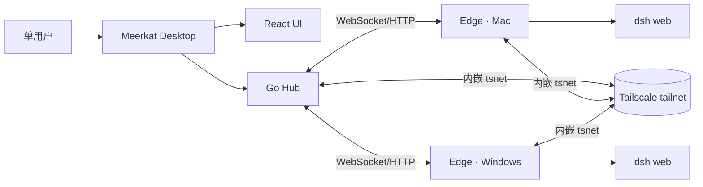
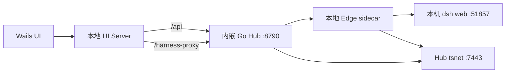
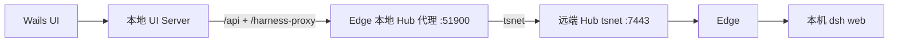
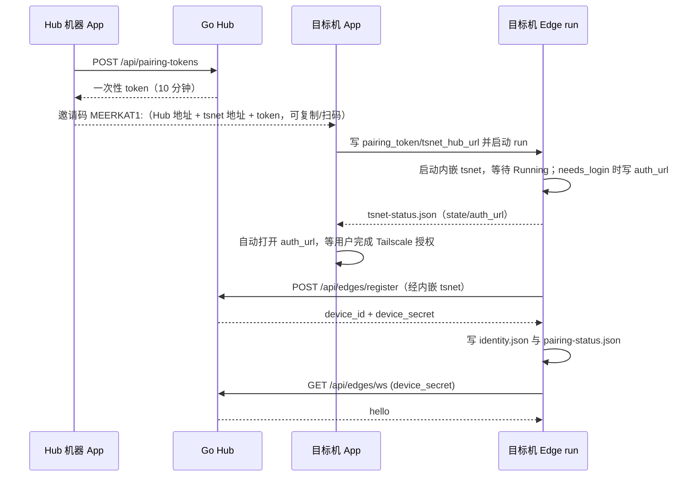
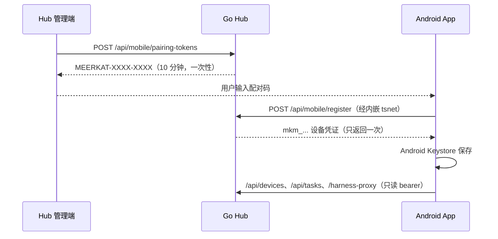
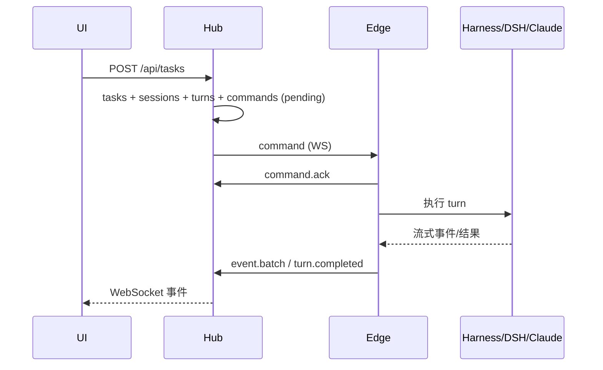

# 系统总览

## 1. 系统上下文

Meerkat 面向单用户、多台受信任设备。用户在一台桌面设备上打开 Meerkat，管理已配对的 macOS/Windows 设备，并在任一设备上打开 DSH。



## 2. 容器与职责

| 组件 | 代码位置 | 职责 |
| --- | --- | --- |
| Desktop Shell | `desktop/MeerkatDesktop/main.go` | Wails 窗口、本地 UI 服务器、Hub/Edge 生命周期、原生窗口/URL、更新、邀请码 |
| Web UI | `web/src` | DSH/设备/任务/看板/会话/设置页面；DSH iframe keep-alive |
| Go Hub | `desktop/MeerkatDesktop/hub` | 设备、任务、会话、命令、附件、DSH URL、认证、SQLite、tsnet |
| Edge | `edge/` | 配对、WebSocket、指标、任务执行、DSH 启动/安装、tsnet、本地 Hub API 代理 |
| DSH | 外部 npm 包 `@deepseek-ai/dsh` | 每台设备上的 Web Harness；由 Edge 管理进程 |
| Android 客户端 | `desktop/MeerkatDesktop/androidclient` | 进程内 tsnet + 本地反代；设备/任务/DSH 只读页；Keystore 凭证与前台服务 |
| 共享协议 | `shared/protocol` | REST/WS 协议 v1 文档与样例 |
| 开发中心 | `center/` | 供 Web 本地开发使用的 Node.js 服务 |

## 3. 运行模式

### 3.1 bundled（内置 Hub）



- 首次启动时，选择「创建新工作区」后才以 `bundled` 模式启动；
- App 首次启动生成 admin token、SQLite、配对 token；
- App 写入本地 Edge 的自配对配置（`pairing_token` + 本地 Hub 地址）后启动 Edge；Edge `run` 自配对成功后进入执行循环；
- 在「设置 → 网络」管理 Hub 的内嵌 Tailscale 节点，默认主机名为 `meerkat-hub`；
- 关闭 App 时清理 Hub/Edge 子进程（SQLite 保留）。

### 3.2 node（加入远端 Hub）



- Hub「接入设备」生成邀请码（`MEERKAT1:...`，可复制或扫码），不再给出命令行；
- 目标机托盘「加入工作区…」粘贴邀请码，写入 `mode: "node"`、Hub URL，以及 Edge 配置的 `tsnet_enabled`、`tsnet_hostname`、`tsnet_hub_url`、`pairing_token`；
- Edge `run` 先启动内嵌 tsnet 并等待 Running，再用一次性令牌经 tailnet 注册；配对完成前不启动本地代理与 WebSocket；
- 首次入网需要浏览器授权一次 Tailscale，App 会自动打开 `auth_url`；同一授权地址只自动打开一次，地址变化在冷却后才会重开，避免反复弹窗；
- UI 的 `/api` 和 `/harness-proxy` **只走 Edge 本地代理**；
- Edge 未配对/等待登录/配对失败时返回 503，并带阶段码 `edge_network_needs_login`、`edge_network_starting`、`edge_pairing_failed`；
- 不读取系统 Tailscale，不回退到 `center_url`。

## 4. 核心数据流

### 4.1 配对与注册



- 配对 token 只保存 SHA-256 hash，消费一次；
- Edge 持久化 `identity.json`（device_id + secret）；
- 管理接口用 admin token 或移动设备凭证访问，也可用 admin token 换取 12h HttpOnly session cookie；
- 修改类请求要求 `x-meerkat-request: 1` CSRF 头；移动设备凭证只读，不能执行修改；
- 移动设备用一次性配对码换取独立凭证，详见 [网络与安全](network-and-security.md#移动设备凭证)。

### 4.1b 移动设备配对



- 移动凭证独立于 Edge `device_secret`，只读 scopes，90 天过期，可撤销/轮换；
- App 本地反代自动注入移动 bearer；Hub 的 `/harness-proxy` 同时接受桌面 session 和移动 bearer。

### 4.2 心跳、指标与设备状态

- Edge 每约 10s 发 `heartbeat`，每约 5s 批量发 `metrics.batch`；
- Hub 更新 `devices.last_seen_at/last_metrics_at` 并广播事件；
- UI 根据心跳时间展示在线/状态陈旧/离线。

### 4.3 任务派发与执行



- 命令为 at-most-once；Edge 本地 outbox 在断线后补发；
- Hub 重启后未确认命令会重新投递（有重复风险，见协议边界）；
- 任务/会话/轮次/工件/附件均落 SQLite，UI 通过 REST + `/api/events` WS 读取。

### 4.4 DSH 打开与 keep-alive

- Edge 启动 `dsh web`，通过 `harness.update` 上报带 token 的 URL；
- Hub 建立每设备本地反向代理，并暴露 `/harness-proxy/{deviceID}/...`；该路径要求桌面 session 或移动凭证；
- Desktop 再为每设备启动本地 origin 代理，把整个 DSH 页面放在独立 loopback origin；
- iframe 由 `PersistentHarnessDetail` 常驻，路由切换只隐藏，不卸载；
- 详见 [dsh-remote-access.md](dsh-remote-access.md)。

### 4.5 DSH 回合通知

- Hub 内置 per-device watcher：每 3 秒经该设备的本地反代调 `POST /api/session/list`，对 `running` 的会话并发 `POST /api/session/wait` 长轮询；
- 只用 unary RPC，不订阅 `/api/remote.mux` 的 `$events`，因此不参与审批/提问的 waterfall 仲裁；
- `reason=idle` 或 `input-required`（同会话 5 分钟冷却）时**直接投递**给桌面端注册的 sink，由桌面端按「开关 → 免打扰 → 系统通知权限」决定是否弹 Wails 通知；
- **通知不落库**：没有历史记录表，也没有列表接口；通知只在弹出的那一刻存在，点击通知仍跳到对应设备的 DSH 页（点击回调按进程内通知 ID 配对，不依赖数据库）；
- 当前只启用本机设备，watcher 按 `deviceID` 管理，接入远程设备只需扩展设备列表；

## 5. 运行依赖、数据与存储

### 5.1 运行依赖

| 依赖 | macOS | Windows |
| --- | --- | --- |
| Wails WebView | WKWebView（系统） | WebView2 Runtime（需现代版本；安装包不更新 Runtime） |
| Node / DSH | 用户设备安装 `@deepseek-ai/dsh`，或 App 内点“安装 DSH” | 同左 |
| 网络 | 内嵌 tsnet，不依赖系统 Tailscale | 同左 |
| 端口 | loopback + tailnet（见 [network-and-security.md](network-and-security.md)） | 同左 |

DSH 由 Edge 安装：

```text
npm install -g @deepseek-ai/dsh@0.2.2-rc.1 --no-audit --no-fund
```

应用运行时不需要 Node Center、pnpm 或仓库；打包命令见仓库根 [Makefile](../../Makefile)。
Windows 安装包特性（当前用户安装、快捷方式、HKCU 自启、卸载保留配置、未签名）见
[desktop README](../../desktop/MeerkatDesktop/README.md)。

### 5.2 数据目录与存储

Hub SQLite（默认 `~/Library/Application Support/Meerkat/center/meerkat.db`，Windows 对应 `%APPDATA%\Meerkat\center`）主要表：

| 表 | 作用 |
| --- | --- |
| `devices` | 设备身份、状态、secret hash、能力 |
| `pairing_tokens` | 一次性配对 token hash |
| `metrics` | 设备指标时序 |
| `web_sessions` | 管理端会话 |
| `tasks` / `sessions` / `turns` | 任务、Harness 会话、轮次 |
| `commands` | 下发给 Edge 的命令与 ack 状态 |
| `events` / `artifacts` / `attachments` | 事件、工件、附件 |

macOS：

```text
~/Library/Application Support/Meerkat/
├── config.json
├── center/meerkat.db
├── center/admin-token
└── edge/identity.json, tsnet-status.json, pairing-status.json, dsh-permission.yml
```

Windows：

```text
%APPDATA%\Meerkat\
├── config.json
├── center\
└── edge\
```

Edge 状态目录：`~/Library/Application Support/Meerkat/edge`（macOS）或 `%APPDATA%\Meerkat\edge`（Windows），包含 `identity.json`、`tsnet-status.json`、`pairing-status.json`（自动配对阶段与错误）、DSH 日志/权限补丁。

更新包下载到配置目录 `updates/`；更新检查默认不发起网络请求，只有配置 `update_manifest_url` 才启用。安装包卸载会保留 `%APPDATA%\Meerkat` 下的配置与 Edge 身份。

## 6. UI 路由

| 路由 | 页面 |
| --- | --- |
| `/#/live/harness` | DSH 设备列表 / 默认入口 |
| `/#/live/harness/:deviceId` | DSH iframe 详情（常驻） |
| `/#/live` | 实时设备 |
| `/#/live/board` | 任务看板 |
| `/#/live/tasks`、`/#/live/tasks/:id` | 实时任务/任务详情 |
| `/#/live/sessions` | 实时会话 |
| `/#/live/settings` | 设置 |
| 其他/旧路径 | 重定向 DSH |

## 7. 当前边界

- 单用户，无多租户/角色权限；
- Hub HTTP 默认 loopback，远端经 tsnet WireGuard 加密，但没有额外 HTTPS 终止；
- DSH 权限为完全权限，依赖受信任设备；
- 桌面应用自带 Go Hub。`center/` 用于独立开发；
- 发布门禁目前是本地单元测试 + Playwright smoke，未接 CI。
